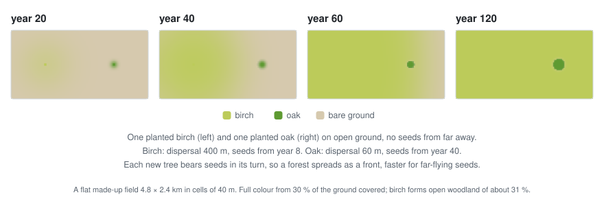
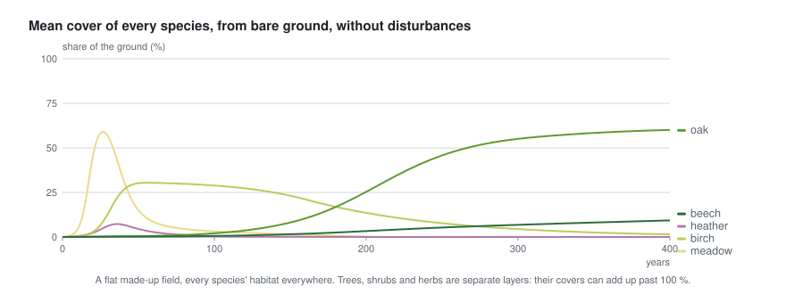
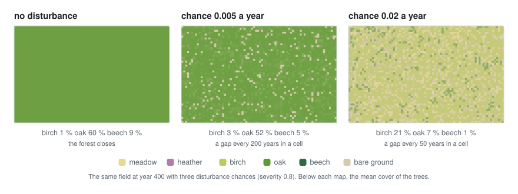
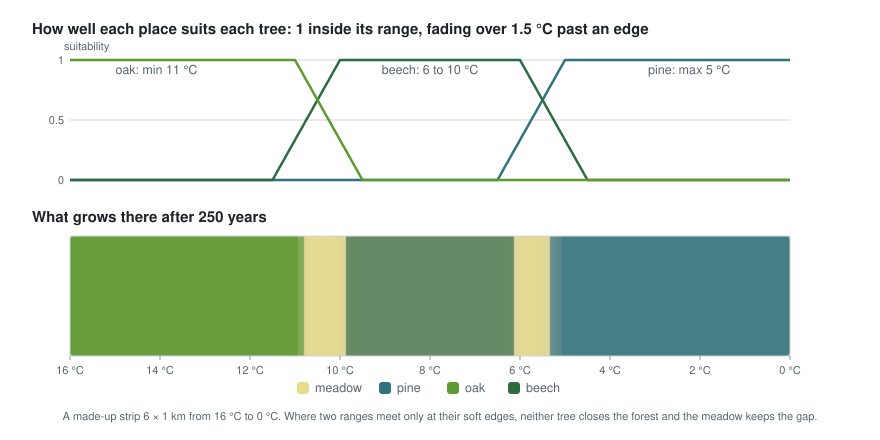

<div align="center">

# Go flora simulator

**Vegetation that grows, year by year, as a plugin for [go-simulator](https://github.com/akrck02/go-simulator).**
Where every species can live, from the climate and the relief in the world, and how plants spread,
compete for light, age and come back after a disturbance, after the LANDIS succession model
(Mladenoff and He 1999; Scheller et al. 2007). It knows nothing about any world: the species, their
traits and their habitats come from the scenario.

[](go.mod)


</div>

> **Note:** this project was written with an AI assistant and is pending thorough review. See the [AI disclosure](#-ai-disclosure).

## 🤖 AI disclosure

I write most of my code by hand, so I want to be clear about this project: **it was written by an
AI assistant (Claude, by Anthropic) under my direction.** I decided what to build and how it should
behave; the code, the tests and the documentation were written by the AI. Every commit made this
way carries a `Co-Authored-By: Claude` line (all of them).

**Status: pending thorough review.** The code compiles and its tests pass, but I have not yet
reviewed it line by line. Treat it as a working draft, not as code I vouch for.

---

<p align="center">
  
</p>

<p align="center"><sub><code>examples/valley.yaml</code> run in go-simulator: a synthetic mountain grows its vegetation from bare ground.</sub></p>

## ✨ What it looks like

<table>
<tr>
<th width="50%">How a forest spreads</th>
<th width="50%">Pioneers, then shade-tolerant trees</th>
</tr>
<tr>
<td><a href="docs/model.md#how-a-forest-spreads"></a></td>
<td><a href="docs/model.md#succession"></a></td>
</tr>
<tr>
<td>Mature plants seed around them, as far as their dispersal; every new plant seeds in its turn.</td>
<td>Light-demanding pioneers take open ground first; trees that bear shade grow under them and take over.</td>
</tr>
<tr>
<th>Disturbances keep pioneers</th>
<th>Each species where its habitat is</th>
</tr>
<tr>
<td><a href="docs/model.md#disturbance"></a></td>
<td><a href="docs/model.md#habitat"></a></td>
</tr>
<tr>
<td>Windthrow and fire open gaps; frequent ones keep a mosaic, rare ones let the forest close.</td>
<td>Habitats are ranges over the climate and the relief, with soft edges.</td>
</tr>
</table>

## 🚀 Quick start

Clone [go-simulator](https://github.com/akrck02/go-simulator), go-simulator-terrain and
go-simulator-climate next to this repository, then grow the example:

```bash
cd ../go-simulator
go run ./cmd/simulate -rules ../go-simulator-flora/examples/valley.yaml -output results/
```

`examples/valley.yaml` grows the vegetation of a synthetic mountain from bare ground: heather
first, then oak in the lowlands and pine on the slopes. A species is a few lines of the scenario:

```yaml
- {id: oak, name: Oak, form: tree, height: 25, longevity: 500, maturity: 40, shade_tolerance: 3,
   dispersal: 60, growth: 0.12, habitat: {temperature: {min: 6}, biome: [land]}}
```

[More on getting started →](docs/getting-started.md)

## 🔍 How it works

<p align="center">
  
</p>

The landscape is a grid over the climate's extent. Every year, in every land cell and for every
species, seeds arrive, saplings take where there is light, plants fill the room left in their
layer and die of age, shade or a habitat that does not suit them, and now and then a disturbance
opens a gap. The plugin never touches the renderer: it answers with fields and events.
[More on how it works →](docs/how-it-works.md)

## 📚 Documentation

| | |
|---|---|
| [Getting started](docs/getting-started.md) | The folders it needs, running the example, what it writes, the tests. |
| [The model](docs/model.md) | Cells, habitats, layers and light, one year, spreading, succession, disturbance, anchors, managed land, outputs. |
| [Writing a scenario](docs/scenario.md) | How to write the species, with an annotated example and advice on traits. |
| [How it works](docs/how-it-works.md) | How the plugin fits go-simulator, what it reads and writes, and how the pictures were made. |
| [Rules reference](docs/rules.md) | The `vegetation` and `vegetation_indicators` rules, generated from the plugin's own description. |
