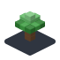
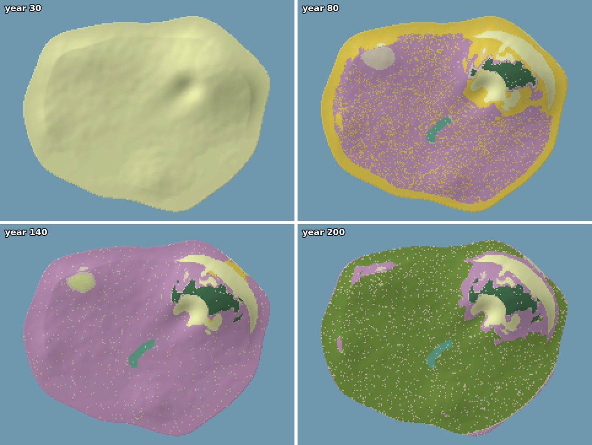

# Welcome to go-simulator-flora 👋

**The flora plugin grows a simulated world's plants**, year by year for centuries: grass first, then shrubs, then pioneer trees, and in the end the forest that fits each place.

Every species is a card of traits (how tall, how long it lives, how far its seeds fly, where it can live). The plugin lets them spread, compete for light and room, and recover from storms, on the ground and weather the other plugins give it.

## Is it for me?

- ✅ You use [go-simulator](https://github.com/akrck02/go-simulator) and want **plants that grow over centuries**.
- ✅ You want to **set it up by writing a rules file**: no programming needed.
- ✅ You are curious about **the science** behind it: the pages explain the model with pictures.

## Where to start

Pick the line that sounds like you.

| If you… | Read | Time |
|---|---|---|
| are **new** and want to see it work | 🏴‍☠️ [The quest](2-the-quest.md): two hundred years of an island's plants, in 5 levels | 45 min |
| want to **run its example** | [Getting started](3-getting-started.md) | 10 min |
| want to **write species** of your own | [Writing a scenario](4-writing-a-scenario.md) | 15 min |
| are **looking up** a parameter | [Rules reference](7-rules-reference.md) | — |

## All the pages, in reading order

The menu on the left (or the files in `docs/`) follows this order.

**Start**

- [Overview](1-overview.md): this page
- [The quest](2-the-quest.md)
- [Getting started](3-getting-started.md)

**Understand**

- [Writing a scenario](4-writing-a-scenario.md)
- [The model](5-the-model.md)
- [How it works](6-how-it-works.md)

**Reference**

- [Rules reference](7-rules-reference.md)

## 🚧 Not done yet

- Plants do not react yet to other plugins' entities: a growing city does not clear the forest,
  and abandoned fields do not grow back.
- Pictures of the 3D viewer itself: the viewer does not draw fields yet, so the pictures in these
  pages are 2D drawings of the fields the plugin published, not screenshots (see
  [how the pictures were made](6-how-it-works.md#how-the-pictures-were-made)).
- Seasons (flowering, leaves) belong to the climate's `seasons` rule, not to this plugin.

## Words you will meet

| Word | What it means |
|---|---|
| Terminal | The window where you type commands: *Terminal* on macOS and Linux, *PowerShell* on Windows. |
| Repository | A project's folder of files, kept on GitHub. `git clone <address>` copies it to your computer. |
| Plugin | A small program that adds one ability to another: here, one kind of simulation each. |
| Rules file | A text file (YAML) that says which plugins to use, with which numbers, for how long: no programming needed. |
| Field | A grid of numbers laid over the world: the height of every spot, its temperature, its rain. |
| Quest | The tutorial of these docs: short levels, each ending with something that works and an achievement. |

## The family

go-simulator-flora is one of a family of small projects that work together:

| Project | What it does |
|---|---|
| [go-renderer](https://github.com/akrck02/go-renderer) | draws 3D scenes and flat interfaces |
| [go-ui](https://github.com/akrck02/go-ui) | buttons, panels and whole applications |
| [go-ui-android](https://github.com/akrck02/go-ui-android) | Android apps that look like Android's own |
| [go-sound](https://github.com/akrck02/go-sound) | sound and music |
| [go-scene-builder](https://github.com/akrck02/go-scene-builder) | 3D scenes from a flat map |
| [go-simulator](https://github.com/akrck02/go-simulator) | simulations that change a scene |
| [go-simulator-terrain](https://github.com/akrck02/go-simulator-terrain) | ground shaped by rivers |
| [go-simulator-climate](https://github.com/akrck02/go-simulator-climate) | weather and biomes |
| **go-simulator-flora** (this one) | forests that grow |
| [go-simulator-urban](https://github.com/akrck02/go-simulator-urban) | towns that grow |
| [go-simulator-motion](https://github.com/akrck02/go-simulator-motion) | a scene that moves |
| [go-3ds](https://github.com/akrck02/go-3ds) | Go on the Nintendo 3DS |

> ⚠️ All of them are **educational experiments**, written with an AI assistant and pending review by their author: good for learning and playing, not for production.
