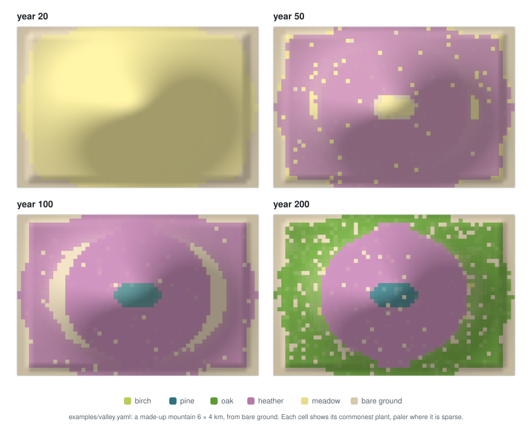
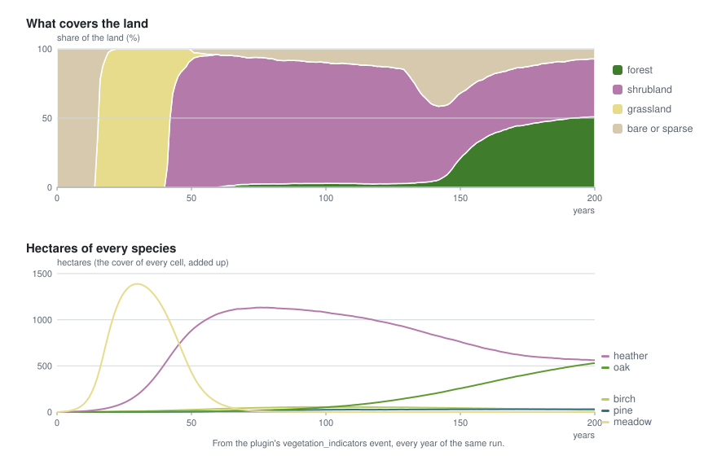

# 🚀 Getting started

## The folders it needs

The plugin is developed next to the projects it uses: `go.mod` replaces go-simulator, go-renderer
and go-scene-builder with the folders beside this one, and the example starts the terrain and
climate plugins from theirs. Clone them side by side:

```
go-renderer/
go-scene-builder/
go-simulator/
go-simulator-climate/
go-simulator-terrain/
go-simulator-flora/   ← this repository
```

## Running the example

```bash
cd ../go-simulator
go run ./cmd/simulate -rules ../go-simulator-flora/examples/valley.yaml -output results/
```

`examples/valley.yaml` grows the vegetation of a synthetic mountain, 6 × 4 km and 1800 m high
(`relieve.json` and `relieve.f32` next to it), from bare ground over 200 years: heather first, then
oak in the lowlands and pine on the slopes. Nothing in it comes from any world.

<p align="center">
  
</p>

The rules file starts three plugins with `go run`, so nothing needs installing:

```yaml
plugins:
  - {name: terrain, command: [go, run, .], directory: ../../go-simulator-terrain}
  - {name: climate, command: [go, run, .], directory: ../../go-simulator-climate}
  - {name: flora, command: [go, run, .], directory: ..}
```

and one stage on a yearly clock, where the relief and the climate come before the vegetation that
reads them:

```yaml
stages:
  - name: valley
    clock: {unit: year, from: 0, to: 200, step: 1}
    snapshots: [50, 100, 200]
    snapshot_fields: [vegetation, tree_cover]
    rules:
      - rule: relief        # terrain: elevation and slope
      - rule: climate       # climate: temperature, precipitation and the biomes
      - rule: vegetation    # this plugin: the species and the landscape's settings
        name: valley
      - rule: vegetation_indicators
        with: {vegetation: valley, years: [50, 100, 200]}
```

The whole species list and every setting are in [writing a scenario](scenario.md); the rules
file's own keys are in go-simulator's
[rules file reference](https://github.com/akrck02/go-simulator/blob/main/docs/rules-files.md).

## What it writes

`cmd/simulate` runs the stage to its end and saves, in the output folder:

| File | What is in it |
|---|---|
| `valley 50 vegetation.f32` and `.json` | the `vegetation` field at year 50: which species marks every cell (−1 for bare ground), with its grid in the `.json` |
| `valley 50 tree_cover.f32` and `.json` | the share of the ground under trees in every cell |
| `valley 50.geojson` | the entities at year 50 (none here) |
| `events.jsonl` | every event: the climate's `biomes`, this plugin's `vegetation` (the names, labels, forms and heights of the species) and `vegetation_indicators` in the listed years |

The same for years 100 and 200. An indicators event looks like this (year 200 of the example):

```json
{"forest_hectares": 1085, "shrubland_hectares": 893, "grassland_hectares": 0, "bare_hectares": 154,
 "hectares_oak": 530.69, "hectares_heather": 562.13, "hectares_pine": 30.99, "hectares_birch": 22.38,
 "hectares_meadow": 0.7, "vegetation": "valley", "year": 200}
```

<p align="center">
  
</p>

Every field and event is described in [the model](model.md#what-it-publishes).

## The tests

```bash
go vet ./...
go test ./...
```

The tests run the plugin inside a go-simulator host on synthetic landscapes and check what must
hold anywhere: every species within its habitat, pioneers followed by shade-tolerant trees,
disturbances keeping pioneers, anchored plants staying (and small crowns covering their share of a
cell), managed land keeping forms out, soft habitat edges, and the same seed giving the same
landscape.
