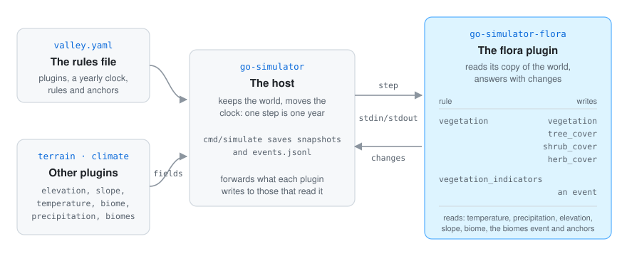
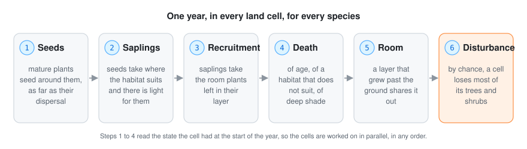

# 🔍 How it works

## How the plugin fits go-simulator

  

go-simulator is the host. It keeps the world (its fields, events and entities) and moves the clock.
The flora plugin is a separate program the host starts (`main.go` serves it over standard input and
output, go-simulator's [protocol](https://github.com/akrck02/go-simulator/blob/main/docs/protocol.md)).

- At the start the plugin **describes** itself: its two rules, their parameters, what each one
  reads and what it writes. That description is also where the [rules reference](rules.md) comes from.
- `vegetation` reads the `temperature`, `precipitation`, `elevation`, `slope` and `biome` fields,
  the climate's `biomes` event and the anchors, and writes the `vegetation`, `tree_cover`,
  `shrub_cover` and `herb_cover` fields (and `cover_<id>` when asked). Its instance name names the
  landscape.
- `vegetation_indicators` reads nothing from other plugins: it measures the landscape of the
  `vegetation` rule it names and emits a `vegetation_indicators` event.

A plugin never touches the renderer: it reads its copy of the world and answers with changes
(go-simulator's [writing plugins](https://github.com/akrck02/go-simulator/blob/main/docs/writing-plugins.md)).
Fields use physical units and shapes world units, as go-simulator's
[vocabulary](https://github.com/akrck02/go-simulator/blob/main/docs/vocabulary.md) lists. The
plugin reads what the terrain and climate plugins publish from the world instead of loading it
again, so they must come before it in the rules file.

## A step

The stage's clock counts years. When the simulation starts, the `vegetation` rule lays the grid over the
climate's extent, samples the fields, works out how well every cell suits every species, plants
the anchored plants and publishes the bare landscape. On every step it simulates the years
the step covers, one at a time:

  

The seeds are spread first, for the whole landscape, with a separable Gaussian kernel (along the
rows, then along the columns). Then every land cell grows, is disturbed and ages, from the state it
had at the start of the year, so the cells are shared out over the processors. The fields are
published again every `publish_every` years. The [model](model.md#one-year) has every formula.

## The code

| File | What is in it |
|---|---|
| `main.go` | starts the plugin |
| `flora/plugin.go` | the two rules, setting up the landscape, anchors and regions |
| `flora/landscape.go` | the grid and how the world's fields are sampled on it |
| `flora/habitat.go` | habitats, soft edges and distances to anchors |
| `flora/species.go` | species, settings, managed land, disturbance |
| `flora/succession.go` | one year: saplings, recruitment, death, room, disturbance, light |
| `flora/dispersal.go` | the seed kernel and the parallel loop |
| `flora/publish.go` | the fields, the names and the indicators |

## How the pictures were made

The maps and charts in these pages were drawn from the plugin's own answers. A small throwaway
program, kept outside the repository, ran the real plugin in a go-simulator host and read the
fields it published after every year:

- **The example mountain** (the README's picture and the charts of its indicators):
  `examples/valley.yaml` with the real terrain and climate plugins, unchanged except for
  `publish_every: 1` and `species_fields: true`, so every year could be drawn. Each cell shows the
  species of the `vegetation` field, paler where it covers less, shaded by the relief.
- **Spreading, succession, disturbance, habitat and managed land**: small made-up flat fields with
  a stand-in for the climate that only names the biomes, and the scenarios written in the pictures'
  captions. The tests use the same kind of synthetic landscape.

They are SVG drawings with their own light and dark colours, not screenshots: the viewer does not
draw fields yet. The maps inside them are the cells of the published fields. The diagrams (how it
fits, a cell, one year, the light) were drawn by hand in the same style; the cell in the landscape
diagram is an example, not a measured one. The pictures of the made-up island in
[the model](model.md#succession) were in the docs before these pages; the scenario they come from
is not in the repository.
