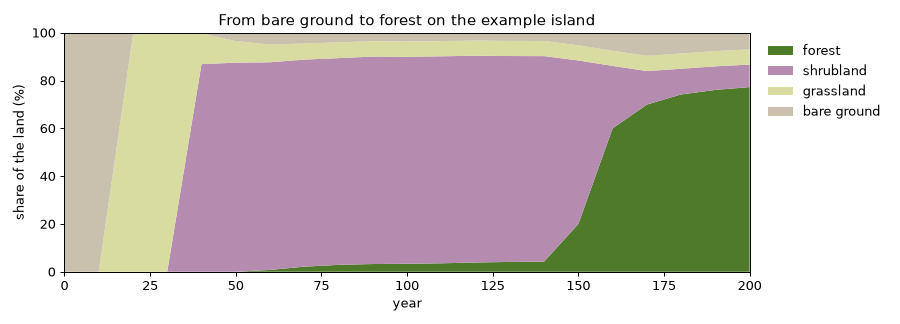

# The flora model

Forests do not appear all at once. On bare ground, grasses and gorse arrive first; then trees that
love the sun, like birch and pine; and, slowly, under their shade, the trees that can wait in the
dark take over. A storm or a fire opens a clearing and the story starts again there. The flora
plugin plays that story, year by year, for every species you give it, wherever the climate and the
land let it live.




*The example island from bare ground: grassland, then a long time of shrubland, and finally the
forest closes after about 150 years.*

It knows nothing about any world: the species, their traits and their habitats come from the
[scenario](scenario.md). This page explains what happens in each cell, every year.

## The landscape

The landscape is a grid over the climate's extent, with cells of `cell` km (default: the
`temperature` field's). At the start the plugin samples, at every cell centre, the fields of the
world: `temperature` and `precipitation` (from the climate plugin), `elevation` and `slope` (from
the terrain plugin) bilinearly, and `biome` by the nearest cell. Land is every cell with a biome
(or above sea level when there is no biome field). The names of the biomes come from the climate's
`biomes` event.

In every land cell, every species has:

- its **cover**: the share of the ground its plants take, 0 to 1;
- its **saplings**: the share of the ground with young plants waiting for room (the advance
  regeneration of LANDIS);
- how many **years** it has grown there, which decides when it bears seeds.

## Habitat

A species' habitat is an envelope over the facts of a cell (bioclimatic envelope models, Busby
1991), written like go-simulator's [conditions](https://github.com/akrck02/go-3d-simulator/blob/feature/simuladores-genericos/docs/vocabulary.md#conditions):

```yaml
habitat:
  temperature: {min: 9, max: 18}        # °C, the yearly mean
  precipitation: {min: 900}             # mm a year
  elevation: {max: 1500}                # metres
  slope: {max: 0.8}                     # rise over run
  biome: [riverbank]                    # one of the climate's biomes
  distance_to_old_oak: {max: 60}        # metres from an anchor of the rules file
```

Inside every range the habitat suits the species fully. Past an edge it fades linearly to nothing
over the fact's **softness** (`softness: {temperature: 1.5, precipitation: 150, slope: 0.1,
distance: 40}`, in each fact's unit; without one, the edge is hard). Values that are not ranges
hold or not. The suitability of a cell is the product of every fact's: 1 where everything suits,
0 where anything is out of reach. It is worked out once, at the start.

## Layers and light

Light is what plants compete for. Every species has a form: **tree**, **shrub** or **herb**. Trees shade shrubs, shrubs shade herbs.

- The light that reaches a layer through the layers above it is `1 − 0.9 × min(1, their cover)`.
- A species needs light by its **shade tolerance** (1 to 5): `need = (5 − tolerance) / 4 × 0.8`,
  so tolerance 5 grows in deep shade and tolerance 1 needs 80 % of full light. With some light it
  keeps `(light − need) / (1 − need)` of its growth, none below what it needs.

## One year

This is the heart of the model. For every land cell and species, from the state at the start of the year:

1. **Seeds.** Mature plants (grown at least `maturity` years in the cell) spread seeds around them
   with a Gaussian kernel as wide as their `dispersal` (metres); `background_seeds` reach every
   cell from far away (birds, storms). Species with `spreads: false` never seed.
2. **Saplings.** Seeds become saplings where the habitat suits the species and there is light for
   them, both in the **gaps** of their layer and **under** its plants:
   - in the gaps, with the light the taller layers leave, less the shade of the plants around the
     gap: tall trees shade a small gap (0.6 when their layer is closed), shrubs less (0.3), grasses
     not at all; the ground a disturbance cleared gets nearly full light;
   - under the plants of their own layer, with the light that reaches the ground.

   `saplings += growth × seeds × suitability × (light in gaps + light under plants) × (1 − saplings)`;
   then 10 % of the saplings die waiting, more where the habitat does not suit.
3. **Recruitment.** Saplings take the room plants left in their layer:
   `recruited = min(saplings, growth × saplings × room × suitability × light from above)`.
4. **Death.** Plants die of age (`1 / longevity` a year), of a habitat that does not suit them
   (up to 20 % a year) and of shade too deep for them (up to 10 % a year).
5. **Room.** If the species of a layer together grew past the ground there is, they share it out
   in proportion.
6. **Disturbance.** With `disturbance.chance` a year, a cell loses `severity` of its trees and
   shrubs (windthrow, fire) and they start again; herbs and saplings stay.

So pioneers that need full light take open ground first and cannot follow themselves under their
own shade, while shade-tolerant species waiting below take over as the pioneers age: succession.
Frequent disturbances keep the pioneers in the landscape; rare ones let the tolerant species close
the forest. A light-demanding species forms open woodland, because it only regenerates where its
own cover leaves enough light.

## Anchors

Anchors of the rules file take part in two ways:

- **Plants** (`role: plant`, `properties: {species, crown}`): a fixed plant, such as an old tree
  the story names. Its species covers the cells within `crown` metres of it or, when the crown is
  smaller than a cell, the share of the cell under it; the other species of its layer make room.
  It is mature from the start and stays every year.
- **Regions** (`role: region`, an outline): areas the indicators measure.

Any anchor can be used in habitats as `distance_to_<anchor id>`, in metres, for plants that grow
near something.

## Managed land

Land people keep, such as fields and orchards: where its condition holds (written like a habitat,
without soft edges), only the listed forms grow.

```yaml
managed:
  - {where: {biome: [fields]}, forms: [herb]}
  - {where: {distance_to_old_oak: {max: 120}}, forms: [herb]}   # a clearing round a tree
```

## What it publishes

| Output | When | Content |
|---|---|---|
| event `vegetation` | start | `names`, `labels`, `forms`, `heights` of the species |
| field `vegetation` | start and every `publish_every` years | the species that most marks every cell: the commonest tree where tree cover reaches 0.3, else the commonest shrub where shrubs reach 0.3, else the commonest herb where herbs reach 0.2; −1 for bare ground |
| fields `tree_cover`, `shrub_cover`, `herb_cover` | the same | share of the ground under each layer |
| fields `cover_<id>` | the same, with `species_fields: true` | cover of every species |
| event `vegetation_indicators` | the listed `years` | hectares of every species; hectares of forest, shrubland, grassland and bare ground; for every region, its forest share and its commonest species |

Put the stage's snapshots at multiples of `publish_every`, and keep only the fields worth saving
with `snapshot_fields`: a large landscape's fields take megabytes each.

## Determinism and speed

The same seed gives the same landscape: the chance of a disturbance comes from a hash of the seed,
the year and the cell, so cells can be worked on in parallel in any order. Cells are spread over
the processors. A landscape of about 700,000 land cells and 18 species takes about a third of a
second a year.

## Known limits

- Plants do not react yet to other plugins' entities: a growing city does not clear the forest,
  and abandoned fields do not grow back.
- The viewer does not draw fields yet; go-scene-builder can sow the vegetation from the
  `vegetation` field as a layer, as it does with biomes.
- Seasons (flowering, leaves) belong to the climate's `seasons` rule.

## Tests

```bash
go test ./...
```

The tests grow synthetic landscapes and check what must hold anywhere: every species within its
habitat, pioneers followed by shade-tolerant trees, disturbances keeping pioneers, anchored plants
staying (and small crowns covering their share of a cell), managed land keeping forms out, soft
habitat edges, and the same seed giving the same landscape.
