# The flora quest

Grow an island's plants from bare ground over two hundred years, one level at a time. Each level
teaches one piece of the flora plugin and ends with the island's vegetation in 3D.

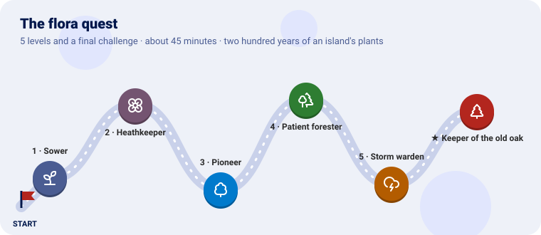

We use the mountain island of [the terrain quest](https://github.com/akrck02/go-simulator-terrain/blob/main/docs/quest.md)
and the weather of [the climate quest](https://github.com/akrck02/go-simulator-climate/blob/main/docs/quest.md).
Grass comes first, then heather, then birches, and over the centuries pine takes the heights and
oak the wet slopes; storms open gaps; and an old oak the story names stands in its clearing.

---

Every level has the same shape: **the idea** (explained with something from everyday life), **the
rules**, a **checkpoint** to know it works, and an optional **bonus**.

---

## Before you start

You need Go 1.25 and GEOS (`sudo apt install libgeos-dev`, `brew install geos`). Clone the
projects side by side, and make a folder for the quest:

```sh
git clone https://github.com/akrck02/go-renderer
git clone https://github.com/akrck02/go-scene-builder
git clone https://github.com/akrck02/go-simulator
git clone https://github.com/akrck02/go-simulator-terrain
git clone https://github.com/akrck02/go-simulator-climate
git clone https://github.com/akrck02/go-simulator-flora
mkdir woods && cd woods
go mod init example.com/woods
```

Put the island's relief in it as `island.json` and `island.f32` (the terrain quest's end
snapshot, renamed), and `empty.geojson`, a map with nothing on it:

```json
{"type": "FeatureCollection", "properties": {"units": "km"}, "features": []}
```

### Looking at the vegetation

The plugin publishes a field `vegetation`: for every cell, the species that marks it most (or −1,
bare ground). `layer/main.go` turns a snapshot of it into a layer go-scene-builder can colour and
sow trees on:

```go
// Command layer turns a snapshot of the vegetation field into a layer go-scene-builder colours and
// sows: the species' names, from the run's events, become the layer's labels, and bare ground
// (−1 in the field) becomes a label of its own, "bare".
//
//	go run ./layer results "island 200" vegetation.json
package main

import (
	"bufio"
	"encoding/binary"
	"encoding/json"
	"log"
	"os"
	"path/filepath"
	"strings"
)

func main() {
	folder, snapshot, out := os.Args[1], os.Args[2], os.Args[3]
	names := speciesNames(filepath.Join(folder, "events.jsonl"))

	var header map[string]any
	content, err := os.ReadFile(filepath.Join(folder, snapshot+" vegetation.json"))
	if err != nil {
		log.Fatal(err)
	}
	if err := json.Unmarshal(content, &header); err != nil {
		log.Fatal(err)
	}
	values, err := os.ReadFile(filepath.Join(folder, snapshot+" vegetation.f32"))
	if err != nil {
		log.Fatal(err)
	}
	cells := make([]float32, len(values)/4)
	if err := binary.Read(strings.NewReader(string(values)), binary.LittleEndian, cells); err != nil {
		log.Fatal(err)
	}
	for index, value := range cells {
		if value < 0 {
			cells[index] = float32(len(names)) // bare ground: the label after the species
		}
	}
	header["labels"] = append(names, "bare")
	written, _ := json.Marshal(header)
	if err := os.WriteFile(out, written, 0o644); err != nil {
		log.Fatal(err)
	}
	file, err := os.Create(strings.TrimSuffix(out, ".json") + ".f32")
	if err != nil {
		log.Fatal(err)
	}
	defer file.Close()
	if err := binary.Write(file, binary.LittleEndian, cells); err != nil {
		log.Fatal(err)
	}
}

// speciesNames reads the names of the species from the vegetation event at the start of the run.
func speciesNames(path string) []string {
	file, err := os.Open(path)
	if err != nil {
		log.Fatal(err)
	}
	defer file.Close()
	lines := bufio.NewScanner(file)
	lines.Buffer(make([]byte, 1<<20), 1<<24)
	for lines.Scan() {
		var event struct {
			Name string `json:"name"`
			Data struct {
				Names []string `json:"names"`
			} `json:"data"`
		}
		if json.Unmarshal(lines.Bytes(), &event) == nil && event.Name == "vegetation" {
			return event.Data.Names
		}
	}
	log.Fatal("no vegetation event in ", path)
	return nil
}
```

`models.yaml`, the trees (go-scene-builder's [models](https://github.com/akrck02/go-scene-builder/blob/master/docs/decoration.md#models)):

```yaml
models:
  fir:
    variants: 3
    vary: {color: 0.1, scale: [0.8, 1.3]}
    parts:
      - {shape: cylinder, radius: 0.3, height: 2, color: "#5a4632"}
      - {shape: cone, radius: 2.2, height: 9, at: [0, 1.5, 0], color: "#2f4a2c", material: {foliage: true}, move: 0.2, grow: 0.15}
  oak:
    variants: 3
    vary: {color: 0.12, warmth: 0.06, scale: [0.8, 1.25]}
    parts:
      - {shape: cylinder, radius: 0.35, top_radius: 0.25, height: 3, color: "#5a4632"}
      - {shape: blob, size: [6, 5, 6], at: [0, 5, 0], wobble: 0.15, move: 0.6, grow: 0.2, color: "#56713a", material: {foliage: true}}
  birch:
    variants: 3
    vary: {color: 0.1, scale: [0.8, 1.2]}
    parts:
      - {shape: cylinder, radius: 0.2, height: 4, color: "#e8e4dc"}
      - {shape: blob, size: [3.5, 6, 3.5], at: [0, 6, 0], wobble: 0.2, move: 0.4, grow: 0.2, color: "#8fae4a", material: {foliage: true}}
```

`view.yaml`, a colour for every species and trees where trees grow:

```yaml
units: m
chunk: 2
models: [models.yaml]
environment: {sun: [250, 25], water_level: 0}
terrain:
  color: "#8a8674"
  biomes:
    bare: {color: "#8a8674"}
    meadow: {color: "#a7b46a"}
    heather: {color: "#8c6d86"}
    birch: {color: "#8fa35a", decorate: [{recipe: scatter, density: 0.0015, models: {birch: 1}}]}
    pine: {color: "#4f6b3a", decorate: [{recipe: scatter, density: 0.002, models: {fir: 1}}]}
    oak: {color: "#56713a", decorate: [{recipe: scatter, density: 0.0015, models: {oak: 1}}]}
    old_oak: {color: "#2f4a22", decorate: [{recipe: scatter, density: 0.0001, models: {oak: 1}, scale: [3, 3]}]}
```

After every run, for the snapshot of year 200:

```sh
go run ./layer results "island 200" vegetation.json
go run ../go-scene-builder/cmd/build-scene -map empty.geojson -relief island.json -layer biome=vegetation.json -style view.yaml -out woods.glb
go run ../go-renderer/cmd/visor woods.glb
```

The pictures were taken with `-zoom 0.75`.

---

## Level 1 · The Sower

| Mission | Pieces | Time |
|---|---|---|
| Grass over the whole island | three plugins in a row, the `vegetation` rule, a species | 8 min |

#### The idea

Plants need ground and weather, and other plugins know those. So three plugins work **like a
relay**: terrain hands the ground to climate, climate hands temperature and rain to flora. They run
in the order of the stage's rules, and none knows the others: they only read the **world**.

A **species** is a card of traits: what it is (`form`: tree, shrub or herb), how tall, how long it
lives, how soon it seeds, how far its seeds fly, and where it can live (`habitat`).

#### Build it

`rules.yaml`:

```yaml
plugins:
  - {name: terrain, command: [go, run, .], directory: ../go-simulator-terrain}
  - {name: climate, command: [go, run, .], directory: ../go-simulator-climate}
  - {name: flora, command: [go, run, .], directory: ../go-simulator-flora}

stages:
  - name: island
    clock: {unit: year, from: 0, to: 200, step: 1}
    snapshots: [20, 50, 100, 200]
    snapshot_fields: [vegetation, tree_cover]
    rules:
      - rule: relief
        with: {path: island.json, origin: [0, 0]}
      - rule: climate
        with:
          cell: 0.1
          temperature: {sea_level: 12, lapse: 6.5}
          rain: {wind_from: 270, background: 450, orographic: 1400}
          biomes:
            - {biome: rock, when: {slope: {min: 0.6}}}
            - {biome: land}
      - rule: vegetation
        name: island
        with:
          background_seeds: 0.002
          disturbance: {chance: 0.004}
          softness: {temperature: 1.5, slope: 0.1}
          publish_every: 10
          species:
            - {id: meadow, name: Meadow, form: herb, height: 0.4, longevity: 20, maturity: 1, shade_tolerance: 2, dispersal: 300, growth: 0.6, habitat: {temperature: {min: -3}}}
      - rule: vegetation_indicators
        with: {vegetation: island, years: [20, 50, 100, 200]}
```

`background_seeds` lets a few seeds reach every cell from far away, so bare ground does not wait
for its neighbours.

```sh
go run ../go-simulator/cmd/simulate -rules rules.yaml -output results/
```

#### Checkpoint

A run of 200 years takes about a second. Look at year 50: green meadow everywhere but the bare
cliffs.

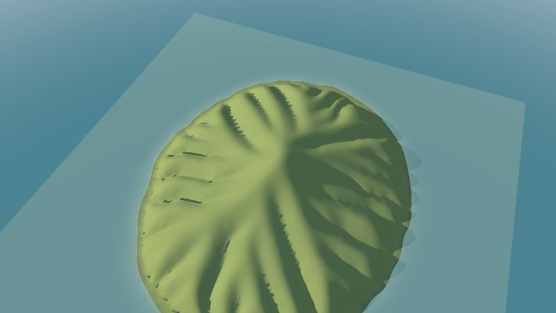


Learn more: [Writing a scenario](scenario.md) · [The model](model.md)

---

## Level 2 · The Heathkeeper

| Mission | Pieces | Time |
|---|---|---|
| Heather that crowds the grass out | a shrub, light and room | 5 min |

#### The idea

Plants in a cell share it like **seats on a bus**: there is only so much room, and taller ones
shade the shorter. A shrub over the grass takes its light, and only grass that bears shade keeps a
seat. Heather is taller than meadow grass and lives longer.

#### Build it

Add to `species`:

```yaml
            - {id: heather, name: Heather, form: shrub, height: 1, longevity: 40, maturity: 3, shade_tolerance: 2, dispersal: 100, growth: 0.3, habitat: {temperature: {min: -1}}}
```

#### Checkpoint

By year 50 heather (purple) covers most of the island; meadow keeps a few patches.

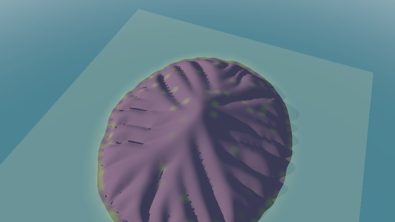


---

## Level 3 · The Pioneer

| Mission | Pieces | Time |
|---|---|---|
| The first trees | a tree, its habitat, dispersal | 5 min |

#### The idea

Birch is a **pioneer**: the first settler of a new town, quick to arrive, quick to build, but not
staying long. It seeds young and its seeds fly far (400 m), but it needs full light
(`shade_tolerance: 1`) and lives only 90 years.

#### Build it

```yaml
            - {id: birch, name: Birch, form: tree, height: 18, longevity: 90, maturity: 8, shade_tolerance: 1, dispersal: 400, growth: 0.35, habitat: {temperature: {min: 0, max: 10}, biome: [land]}}
```

Its `habitat` keeps it between 0 and 10 °C and off the rock biome.

#### Checkpoint

By year 50, birch wood rises on the cooler upper slopes, its trees standing on the scene.

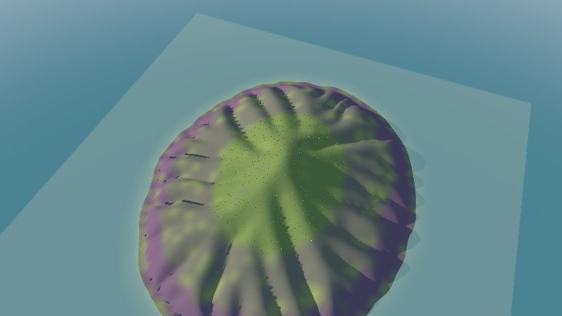


---

## Level 4 · The Patient forester

| Mission | Pieces | Time |
|---|---|---|
| Succession: who comes after the pioneers | shade tolerance, longevity, maturity | 8 min |

#### The idea

Forests change hands like **shifts at a lighthouse**: the pioneers hold it first, but the
patient ones take over. Pine bears more shade than birch and lives 250 years; oak bears more still,
lives 500, but takes 40 years to seed and its acorns fall close (60 m). Slow to arrive, it wins in
the end where it is warm and wet enough. This is **succession**.

#### Build it

```yaml
            - {id: pine, name: Pine, form: tree, height: 25, longevity: 250, maturity: 15, shade_tolerance: 2, dispersal: 150, growth: 0.25, habitat: {temperature: {min: 0, max: 7}, biome: [land]}}
            - {id: oak, name: Oak, form: tree, height: 25, longevity: 500, maturity: 40, shade_tolerance: 3, dispersal: 60, growth: 0.12, habitat: {temperature: {min: 6}, precipitation: {min: 1200}, biome: [land]}}
```

Look at years 50, 100 and 200.

#### Checkpoint

Year 50: birch and heather. Year 100: pine darkens the summit. Year 200: oak closes the forest on
the wet slopes, and heather holds only the dry edges.

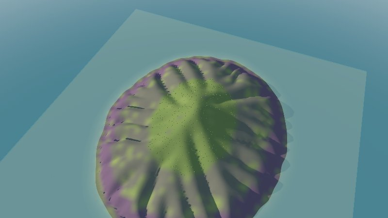

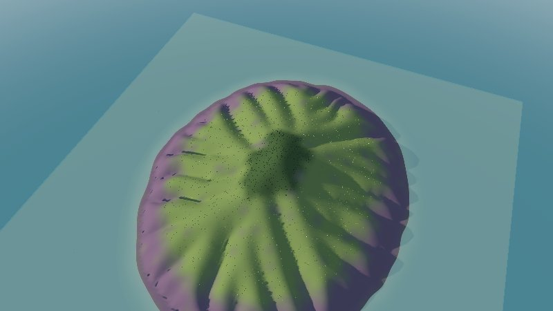

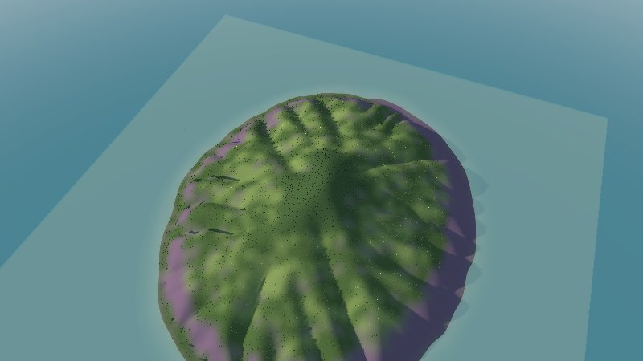

#### Bonus (optional): a beech that waits in the shade

<details>
<summary>🔓 Show the solution</summary>

<pre><code>            - {id: beech, name: Beech, form: tree, height: 30, longevity: 300, maturity: 50, shade_tolerance: 5, dispersal: 40, growth: 0.08, habitat: {temperature: {min: 6}, precipitation: {min: 1400}, biome: [land]}}</code></pre>

It grows under oak and, given centuries, replaces it. Run 400 years to see it.

</details>


Learn more: [Choosing traits](scenario.md#choosing-traits)

---

## Level 5 · The Storm warden

| Mission | Pieces | Time |
|---|---|---|
| Gaps where trees fall, and the forest in numbers | `disturbance`, `vegetation_indicators` | 6 min |

#### The idea

A **storm** knocks trees down, and in the gap the pioneers start again: a forest is never one age.
`disturbance.chance` is the chance a year that a cell is hit; `severity` the share of trees and
shrubs it takes.

To know how much forest there is, the **indicators** rule counts hectares at the years you ask, as
an event.

#### Build it

```yaml
          disturbance: {chance: 0.03, severity: 0.9}
```

#### Checkpoint

Year 200 is patchy: oak and pine broken by heather and birch where storms opened gaps. In
`results/events.jsonl`, the `vegetation_indicators` event of year 200 counts the hectares of every
species and of forest, shrubland, grassland and bare ground.

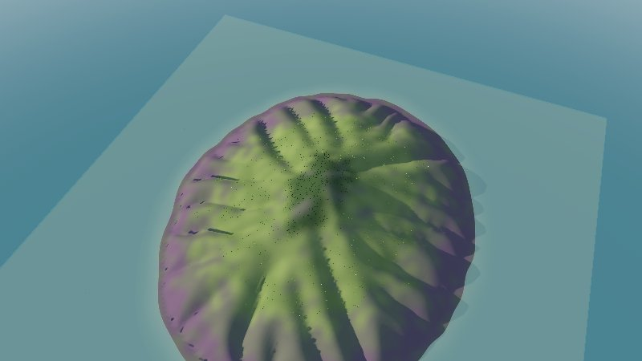

#### Bonus (optional): check it

An objective that fails if the storms leave less than 400 hectares of forest at year 200 (without storms, level 4 had about 1,400; with them, about 460).

<details>
<summary>🔓 Show the solution</summary>

<pre><code>    objectives:
      - {name: a forested island, at: 200, event: vegetation_indicators, value: forest_hectares, min: 400}</code></pre>

</details>


---

## Final challenge · Keeper of the old oak

The story says an **old oak** stands in the north-west of the island, in a **clearing** people keep
open round it; and the low ground by the shore is **fields**, kept as grass.

> **Hint:** an anchor with `role: plant` plants a fixed tree of a species that does not spread
> (`spreads: false`). `managed` land keeps only some forms where its condition holds, and an
> anchor can be named in a condition as `distance_to_<id>`.

Try it on your own first, then compare with the solution.

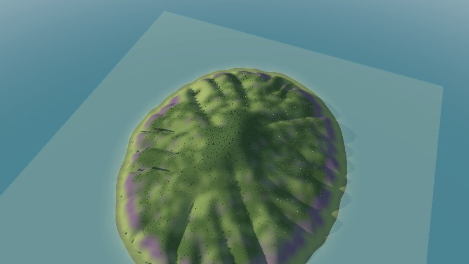

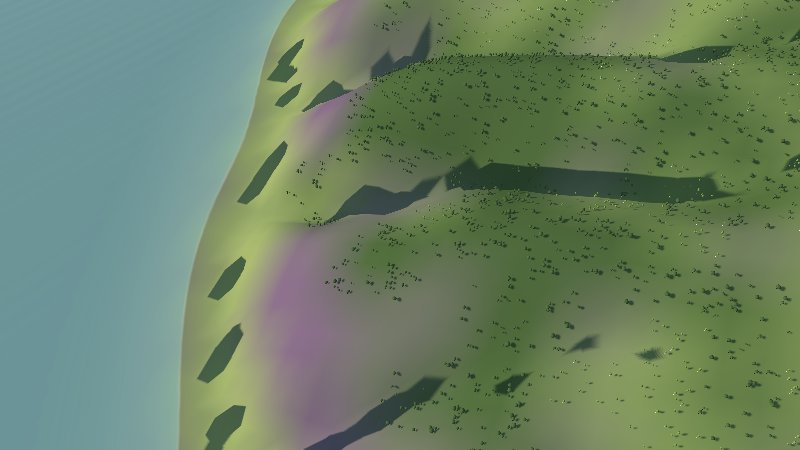

<details>
<summary>🔓 Show the solution</summary>

At the top of the rules file:

<pre><code>anchors:
  - {id: old_oak, role: plant, at: [-1.5, -1.2], properties: {species: old_oak, crown: 150}}</code></pre>

In the vegetation rule:

<pre><code>          managed:
            - {where: {elevation: {max: 120}}, forms: [herb]}
            - {where: {distance_to_old_oak: {max: 400}}, forms: [herb]}</code></pre>

and a species:

<pre><code>            - {id: old_oak, name: The old oak, form: tree, height: 20, longevity: 2000, maturity: 50, shade_tolerance: 3, dispersal: 0, growth: 0.1, spreads: false, habitat: {}}</code></pre>

In `view.yaml`, a colour and one big oak for it:
`old_oak: {color: "#2f4a22", decorate: [{recipe: scatter, density: 0.0001, models: {oak: 1}, scale: [3, 3]}]}`.
The indicators count `hectares_old_oak` and about 300 hectares of meadow kept by people.

</details>


---

## Well done

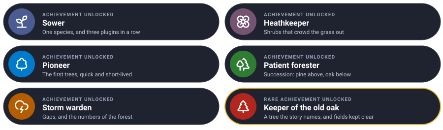

You grew two centuries of vegetation from the laws of light, room and seed, on an island whose
ground and weather were simulated by two other plugins.

### Ideas to keep going

| Idea | Difficulty | Hint |
|---|---|---|
| A field per species | ⭐ | `species_fields: true` publishes `cover_<id>` |
| A region measured on its own | ⭐⭐ | An anchor with `role: region` and an outline: the indicators report it |
| A town in the clearing | ⭐⭐⭐ | [The urban plugin](https://github.com/akrck02/go-simulator-urban) |

## Troubleshooting

| You see | Why, and what to do |
|---|---|
| `no vegetation event` from `layer` | The run did not reach the flora plugin: look at the errors `simulate` printed |
| Everything is bare | No species' habitat fits the island: snapshot `temperature` from the climate and compare |
| The trees are dots | You are far away: `-zoom 0.15` and `-look-at x,z` in the viewer |
| `unknown species` for an anchor | The anchor's `species` must be the `id` of a species in the list |

---

[← All the documentation](README.md)
