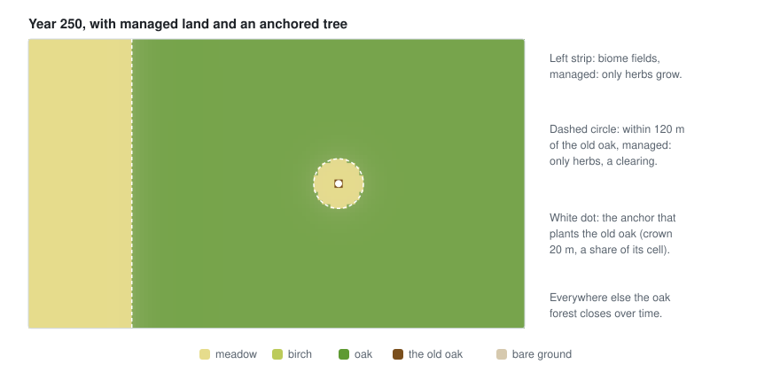

# 📝 Writing a scenario

The scenario is the `with:` of the `vegetation` rule, or a file it includes
(`with: {include: vegetation.yaml}`). It names the species and the landscape's settings.

```yaml
cell: 0.1                        # km between cell centres (default: the temperature field's)
seed: 4
background_seeds: 0.002          # seeds reaching every cell from far away
disturbance: {chance: 0.004, severity: 0.8}   # a gap every 250 years in each cell, on average
softness: {temperature: 1.5, precipitation: 150, slope: 0.1, distance: 40}
publish_every: 10                # years between publishing the fields
managed:
  - {where: {biome: [fields]}, forms: [herb]}
species:
  - id: birch                    # names fields and indicators: no spaces or slashes
    name: Downy birch (Betula pubescens)
    form: tree                   # tree, shrub or herb
    height: 18                   # metres, for the scene
    longevity: 90                # years a plant lives
    maturity: 8                  # years before it bears seeds
    shade_tolerance: 1           # 1: needs full light … 5: grows in deep shade
    dispersal: 400               # metres its seeds usually travel
    growth: 0.35                 # share of the free room it fills in a year
    habitat: {temperature: {min: 2, max: 11}, slope: {max: 0.6}}
  - id: beech
    name: Beech (Fagus sylvatica)
    form: tree
    height: 30
    longevity: 300
    maturity: 50
    shade_tolerance: 5
    dispersal: 40
    growth: 0.08
    habitat: {temperature: {min: 6, max: 11}, precipitation: {min: 1200}, slope: {max: 0.6}}
  - id: meadow
    name: Meadow grasses
    form: herb
    height: 0.5
    longevity: 20                # perennial grasses live for decades as clumps
    maturity: 1
    shade_tolerance: 2
    dispersal: 300
    growth: 0.6
    habitat: {temperature: {min: 0}}
  - id: old_oak
    name: The old oak
    form: tree
    height: 20
    longevity: 2000
    maturity: 50
    shade_tolerance: 3
    dispersal: 0
    growth: 0.1
    spreads: false               # only where an anchor plants it
    habitat: {}
```

And in the rules file, the anchor that plants the old oak:

```yaml
anchors:
  - {id: old_oak, role: plant, at: [1.05, 0.55], properties: {species: old_oak, crown: 20}}
```

<p align="center">
  
</p>

*An anchored old oak with managed land round it, on a made-up field: see [anchors](model.md#anchors)
and [managed land](model.md#managed-land).*

## Choosing traits

The traits follow the species attributes of the LANDIS literature. Some guidance:

| Kind of species | Shade tolerance | Longevity | Maturity | Dispersal | Growth |
|---|---|---|---|---|---|
| Pioneer tree (birch, aspen) | 1 | 60–120 | 5–10 | 200–500 m | 0.3–0.4 |
| Light-demanding conifer (pine) | 2 | 150–300 | 10–20 | 100–200 m | 0.2–0.3 |
| Mid-tolerant broadleaf (oak) | 3 | 300–600 | 25–50 | 30–100 m (acorns) | 0.1–0.15 |
| Shade-tolerant (beech, fir) | 5 | 250–450 | 30–60 | 30–60 m | 0.05–0.1 |
| Shrub (heather, gorse) | 1–3 | 20–80 | 3–5 | 50–150 m | 0.25–0.4 |
| Grass or herb | 1–2 | 10–30 | 1–2 | 100–300 m | 0.4–0.6 |

- A forest closes in 150–250 years from bare ground; shade-tolerant trees need longer.
- `background_seeds` around 0.001–0.005 lets every species appear wherever it suits, slowly.
- A disturbance chance of 0.002–0.01 a year gives landscapes from closed forest to a mosaic of
  pioneers and late species.
- The [succession](model.md#succession) and [disturbance](model.md#disturbance) pictures show
  what these numbers do on a made-up field.
- Give real species habitats from their real climate (yearly mean temperature and rain), then
  soften the edges a little so the ranges blend.
